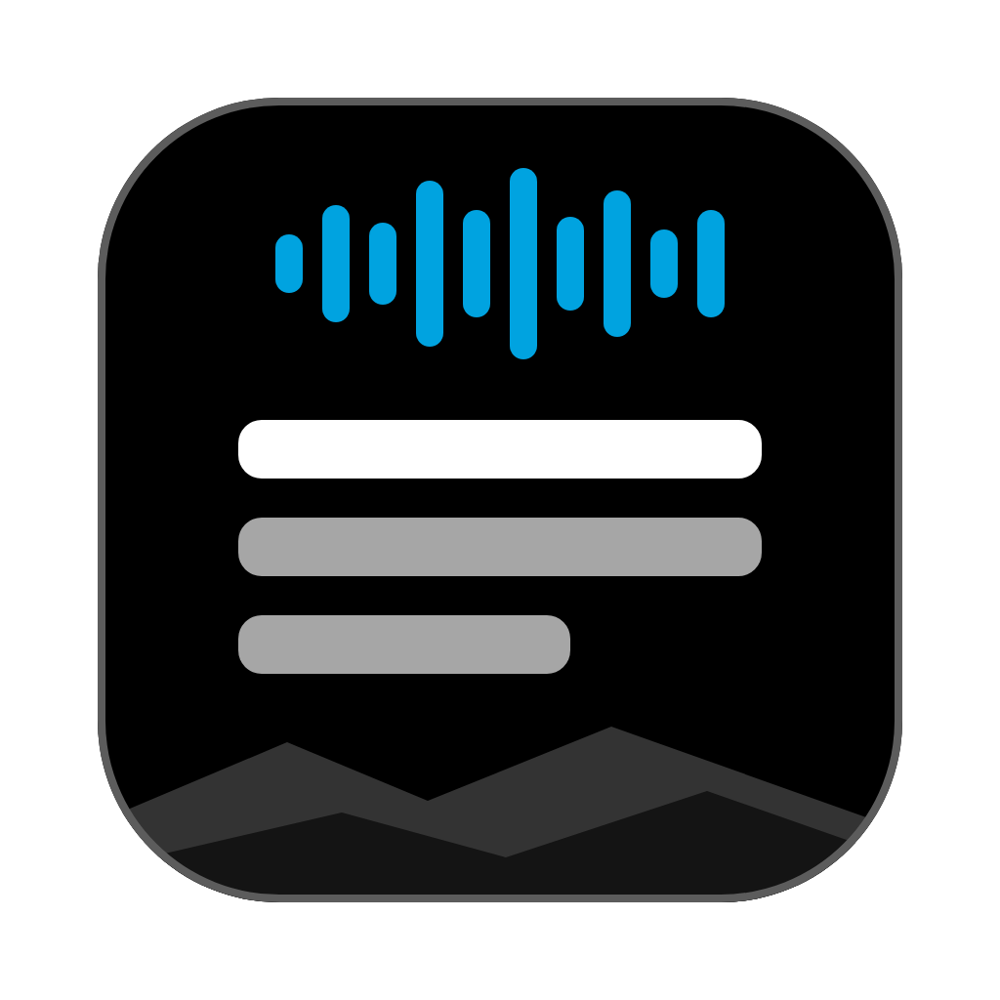
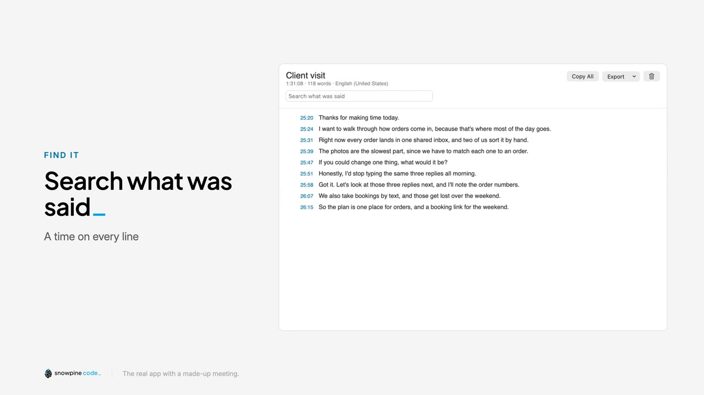

<p align="center"></p>

# Snowpine Transcribe

A free, open source Mac app that turns your recordings into searchable transcripts, right on your Mac.
Made by [Snowpine Code](https://snowpinecode.com).

**[See the page and the short video](https://snowpinecode.github.io/snowpine-transcribe/)**

[](https://snowpinecode.github.io/snowpine-transcribe/)

Drop in a recording or a video and get text with a time on every line. Nothing is uploaded, and there's nothing to pay per minute.

## What it does

- **Audio or video.** Voice Memos, Zoom recordings, phone videos and more. Every sound track in a file is mixed in, so people on separate tracks aren't lost.
- **Fast.** In my test, a 4 hour recording took about 2 minutes on an M5 MacBook Pro. Your speed will depend on your Mac and your recording.
- **Search.** Find anything that was said.
- **Check it by ear.** Click a time to hear that moment.
- **Take it with you.** Copy it, or save it as text, Markdown, SRT or WebVTT subtitles, or JSON.
- **Keeps your transcripts.** They stay in the app until you delete them.
- **One-click updates.** It tells you when a new version is out, and one click installs it.

It doesn't record meetings or label who's talking.

## Install

**Download it:**

1. [Download the zip](https://github.com/snowpinecode/snowpine-transcribe/releases/latest/download/Snowpine-Transcribe.zip), open it, and drag Snowpine Transcribe to Applications.
2. Open it. The app isn't signed with a paid Apple developer certificate, so macOS says it was blocked. Click **Done**.
3. Go to System Settings > Privacy & Security, scroll down and click **Open Anyway**.
4. In the box that pops up, click **Open Anyway** again (not Move to Trash), then confirm with your password or Touch ID. You only do this once.

**Or build it yourself,** which takes about a minute and skips the warning. You need the Xcode Command Line Tools (run `xcode-select --install` once) or Xcode.

```bash
git clone https://github.com/snowpinecode/snowpine-transcribe.git
cd snowpine-transcribe
scripts/build-app.sh --install
```

## Updating

Snowpine Transcribe tells you when a new version is out, and one click installs it. Nothing installs without that click. Choose **Snowpine Transcribe > Check for Updates…** any time, or turn off **Check for Updates Automatically**. With it off, no check starts unless you ask.

Version 0.1.0 can't update itself: [download the newest version](https://github.com/snowpinecode/snowpine-transcribe/releases/latest/download/Snowpine-Transcribe.zip) once and replace the old copy. Your saved transcripts stay where they are.

## Requirements

- macOS 26 or later, because it uses Apple's newer speech engine (`SpeechAnalyzer`). Tested on an Apple silicon MacBook Pro.
- If macOS doesn't have the speech model for your language, it downloads it once. macOS does that, not the app.

## Accuracy

It's usually good on clear speech, but it can mishear names, numbers and unusual words. Check anything important by clicking its time and listening.

## Privacy

- Speech is recognized **on your Mac** by Apple's on-device engine.
- The app runs in the **macOS App Sandbox with no network entitlement**, so macOS itself blocks it from the internet. The app's own code has no networking calls, and CI checks that it stays that way (`scripts/check-no-network.sh`).
- **The only network use is checking for updates.** That is done by the Downloader helper in [Sparkle](https://sparkle-project.org), an open source update tool. It fetches only the update feed and the new version from GitHub, over https. Your recordings and transcripts are never part of it. You can turn off automatic checks in the app menu.
- Each update must carry a valid signature matching the key in the app, checked before it is unpacked.
- It never uses your microphone or camera. It only opens files you choose.
- No accounts, analytics or tracking.
- Your recording is never copied. Transcripts, and a pointer back to the recording for playback, are saved in the app's own folder until you delete them.

If you record other people, ask them first.

## Build and test

```bash
scripts/test.sh          # unit tests, no-network check, render check
scripts/check-engine.sh  # end to end with the real speech engine on this Mac
scripts/build-app.sh     # build/Products.noindex/Snowpine Transcribe.app
```

Exports, search and the transcript model live in `Sources/SnowpineTranscribeCore` (no UI, unit tested). The app is in `Sources/SnowpineTranscribe`. You can also run `SnowpineTranscribe --transcribe <file>` to print a transcript.

See [docs/MAINTAINING.md](docs/MAINTAINING.md) for releases.

## Contributing

Issues and pull requests are welcome. Please keep the privacy promises: no network access in the app itself (only Sparkle's Downloader helper, for updates), no microphone, nothing uploaded. `scripts/test.sh` must pass.

## License

MIT. See [LICENSE](LICENSE). The bundled Inter and Plus Jakarta Sans fonts are under the SIL Open Font License (see `Resources/Fonts`). Sparkle, the one third-party dependency, is under its own MIT-style license (see `Resources/Sparkle-LICENSE.txt`) and pinned to an exact version in `Package.swift`. The Snowpine Code name and logo are not part of the MIT grant.
